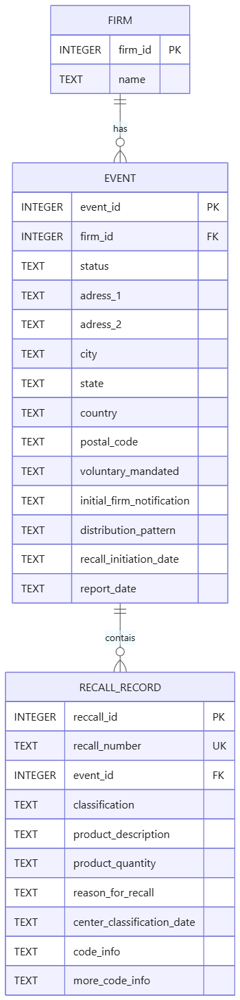

# Design Document

By Carmen Sarría

Video overview: https://youtu.be/lBierGSK3tI


## Scope

The purpose of this database is to store, manage, and analyze FDA medical device recall enforcement information in a relational SQLite database.

The database is based on the FDA openFDA Device Enforcement dataset. The dataset used for this project contains 39,969 recall records, representing 14,996 unique recall events and 3,054 distinct recalling firms.

The database includes three main entities: firms, recall events, and individual recall records. A firm represents an organization associated with one or more recall events. An event represents an FDA recall event and contains information such as its status, firm, address, distribution pattern, and dates. A recall record represents an individual record associated with an event and contains information such as the recall number, classification, product description, product quantity, reason for recall, and code information.

The database is intended to support analysis and management of publicly available FDA recall information. Users can investigate recall activity by firm, event, classification, date, and other attributes.

Outside the scope of the database are information and workflows that are not present in the source dataset, including individual customer complaints, adverse event investigations, corrective and preventive actions (CAPAs), internal company responsibilities, internal communications, and other organization-specific post-market surveillance activities. The database therefore represents FDA recall enforcement information rather than a complete post-market surveillance system.


## Functional Requirements

A user should be able to:

- Find recall events associated with a particular firm.
- Count recall records by FDA classification.
- Identify firms associated with the largest numbers of recall events.
- Identify events containing the largest numbers of recall records.
- Find recall records initiated within a specified date range.
- Find ongoing Class I recall records.
- Summarize recall records by event status and classification.
- Add a new recall record associated with an existing event.
- Update the status of an existing recall event.
- Delete a recall record from the local database.

The database is designed to support both analytical read operations and basic maintenance operations through `SELECT`, `INSERT`, `UPDATE`, and `DELETE` statements.

The database does not provide a complete workflow for managing a medical device recall. In particular, users cannot use this database to manage complaints, investigations, CAPAs, internal approvals, or other information that is not represented in the source dataset. It also does not automatically synchronize changes with the FDA or provide a web-based user interface.


## Representation

### Entities

The database contains three entities: `firm`, `event`, and `recall_record`.

#### Firm

The `firm` table stores the medical device firms associated with recall events.

Its attributes are:

- `firm_id`: an `INTEGER` primary key used as an internal identifier.
- `name`: the firm's name, stored as `TEXT` and required with `NOT NULL`.

An internal integer identifier is used instead of the firm name as the primary key because firm names are descriptive attributes rather than reliable identifiers. Separating firms from events also avoids repeatedly storing the same firm name for every event associated with that firm.

#### Event

The `event` table stores FDA recall events.

Its attributes are:

- `event_id`: the FDA event identifier, stored as an `INTEGER` primary key.
- `firm_id`: an `INTEGER` foreign key referencing `firm`.
- `status`: the event status, stored as required `TEXT`.
- `address_1` and `address_2`: address information from the source dataset.
- `city`, `state`, `country`, and `postal_code`: geographic information from the source dataset.
- `voluntary_mandated`: information about whether the recall was voluntary or mandated.
- `initial_firm_notification`: information about the firm's initial notification.
- `distribution_pattern`: the distribution information provided by the source.
- `recall_initiation_date`: the recall initiation date, stored as required `TEXT` in `YYYY-MM-DD` format.
- `report_date`: the FDA report date, stored as required `TEXT` in `YYYY-MM-DD` format.

The event-level attributes were selected after examining the source data. Each of the 14,996 events is associated with exactly one recalling firm, status, recall initiation date, report date, voluntary/mandated value, and initial firm notification value in the dataset.

Address information is stored at the event level rather than the firm level because the same firm can appear with different addresses across different events.

#### Recall Record

The `recall_record` table stores individual recall records associated with FDA events.

Its attributes are:

- `recall_id`: an internal `INTEGER` primary key.
- `recall_number`: the source recall number, stored as `TEXT` and declared `UNIQUE`.
- `event_id`: an `INTEGER` foreign key referencing `event`.
- `classification`: the FDA recall classification, stored as required `TEXT`.
- `product_description`: the recalled product description, stored as required `TEXT`.
- `product_quantity`: the source quantity information, stored as nullable `TEXT`.
- `reason_for_recall`: the reason provided by the source, stored as required `TEXT`.
- `center_classification_date`: the classification date, stored as nullable `TEXT` in `YYYY-MM-DD` format.
- `code_info`: source code information, stored as nullable `TEXT`.
- `more_code_info`: additional source code information, stored as nullable `TEXT`.

An internal `recall_id` is used as the primary key because one source record has an empty recall number. The 39,968 non-empty recall numbers are unique in the dataset, so `recall_number` is also constrained with `UNIQUE`.

Several attributes were deliberately kept at the recall-record level rather than the event level. Analysis showed that some events contain multiple classifications and multiple reasons for recall. Moving these attributes to the event table would incorrectly imply that every event has only one classification or reason.

`product_quantity` is stored as `TEXT` because the source values are heterogeneous. Many values contain textual quantities such as numbers of cases, while some values are numeric strings and some are empty. Storing the source representation as text avoids losing information by forcing all values into a numeric format.

Dates are stored as `TEXT` in ISO `YYYY-MM-DD` format. The source dataset provides dates as `YYYYMMDD`, so `load_data.py` converts them before insertion.

Optional source values are represented as `NULL` when the source does not provide a value.

Two source fields were intentionally excluded from the schema. `product_type` contains the same value, `Devices`, for every record and therefore does not provide useful information within this dataset. The `openfda` object is empty for all records and was therefore also excluded.


### Relationships

The database contains two one-to-many relationships.

A `firm` can be associated with many `event` records, while each `event` is associated with one `firm`.

An `event` can contain many `recall_record` records, while each `recall_record` belongs to one `event`.

The relationships are implemented through foreign keys:

- `event.firm_id` references `firm.firm_id`.
- `recall_record.event_id` references `event.event_id`.

The one-to-many relationship between events and recall records is particularly important. Analysis of the source data showed that a single event can contain multiple recall records. For example, event `68536` contains 233 recall records. Therefore, representing every source record as a separate event would not accurately represent the source data.

The entity relationship diagram is included below.



Foreign-key enforcement was enabled during testing and data loading. After loading all 39,969 records, `PRAGMA foreign_key_check` returned no violations.


## Optimizations

Two explicit indexes were created to support the database's representative queries.

The first index is:

```sql
CREATE INDEX IF NOT EXISTS "idx_event_recall_initiation_date"
ON "event" ("recall_initiation_date");
```

This index supports queries that filter recall events by initiation date and order them by that date. Query-plan analysis showed that, before indexing, SQLite scanned the relevant tables and used a temporary B-tree for the requested ordering. After the date index and the event-record join index were added, SQLite was able to search the `event` table using the date index and avoid the temporary B-tree for the date-range query.

The second index is:

```sql
CREATE INDEX IF NOT EXISTS "idx_recall_record_event_id"
ON "recall_record" ("event_id");
```

This index supports joins between `recall_record` and `event`, since `event_id` is frequently used to connect the two tables. It also supports queries that group recall records by event.

No additional indexes were added simply because a column appears in a `WHERE` clause. For example, `status` and `classification` have relatively few distinct values in this dataset, and query-plan testing did not provide sufficient evidence that additional indexes on those columns would improve the representative queries enough to justify them.

Primary keys and the `UNIQUE` constraint on `recall_number` are also indexed by SQLite as required to enforce those constraints.


## Limitations

The database represents a snapshot of publicly available FDA medical device recall enforcement information rather than a complete operational recall-management system.

The source dataset is external and may change over time. The database therefore represents the specific dataset used for this project rather than a continuously synchronized copy of FDA data.

The database also preserves several fields as source text because the dataset does not provide sufficiently consistent structure to justify further normalization. In particular, `product_quantity`, `code_info`, `more_code_info`, `distribution_pattern`, and `reason_for_recall` contain semi-structured or free-text information. Converting these fields into additional entities or numeric structures could result in information loss or assumptions not supported by the source data.

The source data also contains occasional inconsistencies. For example, a small number of events contain more than one classification or more than one reason for recall. One event also contains slightly different textual representations of its distribution pattern. The schema was designed to preserve these observations rather than forcing them into relationships that the data does not consistently support.

Finally, the database does not model information outside the FDA Device Enforcement dataset, such as individual complaints, investigations, CAPAs, internal responsibilities, or other organization-specific post-market surveillance activities.
